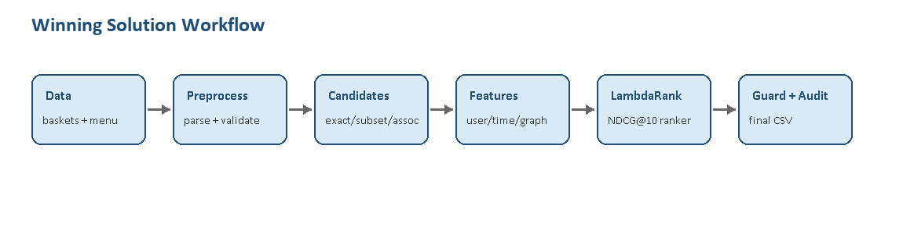
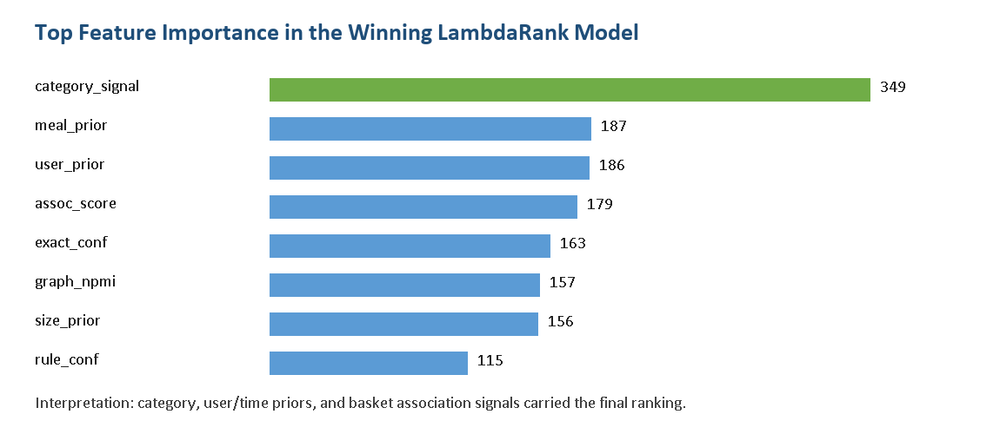

# Restaurant Basket Recommendation System

A machine learning recommendation project for **hidden-item basket completion**.  
Given the visible items in a restaurant order, the system ranks the **top 10 menu items** most likely to be the missing item.

The project combines market-basket signals, contextual features, and a **LightGBM LambdaRank** model to optimize recommendation ordering with **NDCG@10**.

## Highlights

- Built a ranking-based recommendation pipeline for restaurant basket completion
- Engineered **89 candidate-level features**
- Used co-occurrence and association signals such as confidence, lift, NPMI, and chi-square
- Added user, meal-period, category, role, sequential, and context features
- Trained and tuned a **LightGBM LambdaRank** meta-ranker
- Evaluated recommendations using NDCG@10 and Hit@K metrics
- Achieved a **private NDCG@10 of 0.7841**

## Problem

The input contains the items currently visible in a restaurant basket. One item is hidden.

The task is to predict and rank the 10 most likely missing items. Because ranking quality matters, the main evaluation metric is **NDCG@10**.

## Approach

The pipeline evolved through several stages:

1. **Data preparation**
   - Parsed basket item lists
   - Validated menu item IDs
   - Sorted transactions chronologically
   - Built train/validation splits

2. **Candidate generation**
   - Popularity and meal-period baselines
   - Co-occurrence and association rules
   - Exact-context matching
   - Subset backoff for sparse basket contexts

3. **Feature engineering**
   - Basket-context features
   - Association confidence, lift, NPMI, and chi-square
   - Category and menu-role features
   - User preference priors
   - Meal and time features
   - Sequential/contextual signals
   - Ranker-consensus features

4. **Learning to rank**
   - Candidate-level training data
   - LightGBM LambdaRank
   - Hyperparameter and seed evaluation
   - Guard rules for sensitive top-ranked recommendations

5. **Evaluation**
   - NDCG@10
   - Hit@1, Hit@3, Hit@5, Hit@10
   - Output validation and recommendation integrity checks

## Results

| Metric | Score |
|---|---:|
| Private NDCG@10 | **0.7841** |
| Internal NDCG@10 | 0.7712 |
| Hit@1 | 0.6160 |
| Hit@3 | 0.7794 |
| Hit@5 | 0.8636 |
| Hit@10 | 0.9441 |

## Project Structure

```text
restaurant-basket-recommendation-system/
├── src/
│   ├── lambdarank_meta_toolkit_tuning.py
│   ├── lambdarank_meta_experiment.py
│   ├── lambdarank_meta_v2_experiment.py
│   ├── exact_ordered_multi_patch_experiment.py
│   ├── build_level3_role_basket_completion.py
│   ├── build_weak_slice_assoc_reranker.py
│   └── investigate_ordered_context.py
├── assets/
│   ├── feature_importance_chart.png
│   └── workflow_figure.png
├── results/
│   └── metrics.json
├── requirements.txt
└── README.md
```

## Workflow



## Feature Importance



## Technologies

- Python
- Pandas
- NumPy
- scikit-learn
- LightGBM
- XGBoost
- Learning to Rank
- Feature Engineering
- Association Analysis

## What I Learned

This project strengthened my experience in:

- Building an end-to-end recommendation pipeline
- Designing features from transactional and behavioral data
- Working with ranking models instead of standard classification
- Comparing experiments using reproducible evaluation metrics
- Balancing model performance with recommendation-quality checks

## Data

The original competition datasets and submission files are **not included in this public repository**.  
The source code is provided to demonstrate the modeling, feature-engineering, evaluation, and ranking workflow used in the project.

## Note

This was completed as a university team data-mining competition project.
